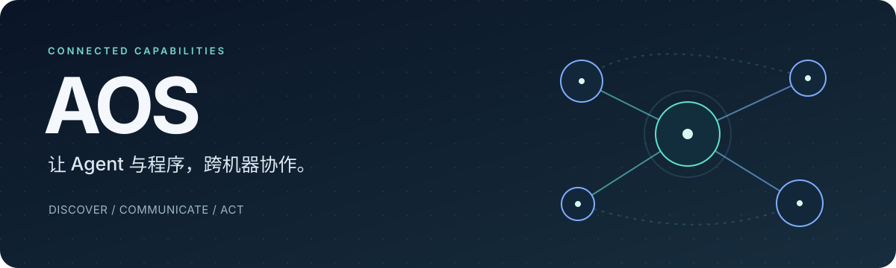
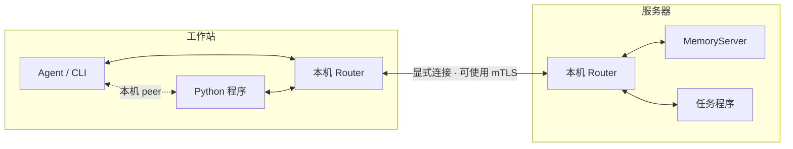

<p align="center">
  
</p>

<p align="center">
  <strong>发现能力 · 交换消息 · 调用服务 · 协作完成任务</strong>
</p>

<p align="center">
  <a href="https://github.com/Cmoon-cyl/aos/releases">下载发行版</a> ·
  <a href="docs/getting-started.md">快速开始</a> ·
  <a href="docs/README.md">使用文档</a> ·
  <a href="docs/python-sdk.md">Python SDK</a> ·
  <a href="docs/cli.md">CLI</a>
</p>

---

AOS 让**不同机器、不同位置的 Agent 和普通程序协作**。程序把能力注册为 Node，
通过 Topic 交换消息、Service 处理请求、Action 执行可反馈和可取消的任务。
Agent 可以发现在线能力、读取接口与副作用说明，再通过结构化 JSON 调用。

核心由 Rust 实现，Python SDK 与原生 CLI 共用同一套协议。每个应用进程持有自己的
Node 和业务状态；每台机器的 Zenoh Router 负责连接本机与其他机器。

## 用 AOS 做什么

| 需要 | 对应能力 |
| --- | --- |
| 找到另一台机器上的程序与接口 | Graph 发现、NodeCard 描述、JSON Schema 类型校验 |
| 连续发送状态、事件或传感数据 | **Topic**：发布/订阅、QoS、过滤、条件与脚本 hook |
| 读取数据或执行一次短操作 | **Service**：请求/响应、明确的超时、无隐式重试 |
| 执行耗时任务并观察进度 | **Action**：受理、反馈、终态结果、协作取消 |
| 启动和管理一组本机程序 | 安装包索引、`run` / `launch`、依赖与就绪检查、有限重启 |
| 管理长期运行的 Node | 参数、lifecycle、Clock/Timer、诊断与有界遥测 |
| 保存消息并复现观察过程 | **bag**：MCAP 录制、检查、恢复与受控回放 |
| 安全连接多个地点 | mTLS、默认拒绝 ACL、每机 Router 与显式跨 Router 连接 |

## 一键安装

**macOS Apple Silicon / Linux x86_64（glibc）：**

```sh
curl -fsSL https://raw.githubusercontent.com/Cmoon-cyl/aos/main/install.sh | sh -s -- --non-interactive --json
```

**Windows x64，在 PowerShell 中运行：**

```powershell
powershell -NoProfile -ExecutionPolicy Bypass -Command "& ([scriptblock]::Create((irm 'https://raw.githubusercontent.com/Cmoon-cyl/aos/main/install.ps1'))) --non-interactive --json"
```

安装器校验发行包，准备独立 Python、SDK、CLI 和 Router，再启动临时服务验证
`17 + 25 = 42`，验证后停止测试进程。无需 GitHub 登录、预装 Python 或 Rust。
结果以 JSON 返回绝对 CLI 路径、Python 路径和验证状态。

默认安装到 `~/.local/share/aos`（Windows 为 `%USERPROFILE%\.aos`），
可用 `--prefix PATH` 指定位置。安装器会注册用户级 `aos` 命令；终端加载更新后的 PATH 后，
可直接运行 `aos --version`。当前终端也可直接使用安装结果中的 CLI 路径。
使用 `--no-path` 可跳过 PATH 和 shell 配置。

```sh
"$HOME/.local/share/aos/bin/aos" env ensure
"$HOME/.local/share/aos/bin/aos" update check
"$HOME/.local/share/aos/bin/aos" update apply
```

详细参数、更新和回滚见[一键安装与维护](docs/agent-installation.md)。
手动解压平台包见[安装指南](docs/install.md)；自己启动 provider 的完整示例见
[快速开始](docs/getting-started.md)。

## 给 Agent 和插件用户

把下面这句话交给有终端工具的 Agent：

> 阅读 https://github.com/Cmoon-cyl/aos/blob/main/docs/for-agents.md，在你实际执行工具的机器上安装 AOS，验证可用后继续我的任务。

安装命令追加 `--agent codex`、`--agent claude` 或 `--agent trae`，
可以同时安装对应的 AOS Skill。参数可重复使用。

完整[插件](plugins/aos/README.md)提供安装、使用和 Python 开发三个 Skill。
Codex CLI 可运行：

```sh
codex plugin marketplace add Cmoon-cyl/aos
codex plugin add aos@aos
```

Claude Code 可运行：

```text
/plugin install aos --marketplace Cmoon-cyl/aos
```

插件安装后运行它的 setup；首次使用也会检查并补齐 AOS 环境。
运行时安装在 Agent 的实际执行机器上，桌面端安装插件不会自动安装到其他主机。

## 一台机器起步，多台机器协作



同机 peer 通过 gossip 发现可连接的邻居；跨机通过显式 Router 连接交换消息。
一端建立连接后，业务可以双向运行。gossip 不会打开防火墙或穿透 NAT；
跨网需要可达的入口及对应证书、权限配置。见[部署指南](docs/deployment.md)。

## 文档导航

| 开始使用 | 开发应用 | 部署与维护 |
| --- | --- | --- |
| [安装与校验](docs/install.md) | [Python SDK](docs/python-sdk.md) | [单机与多机部署](docs/deployment.md) |
| [Agent 安装入口](docs/for-agents.md) | [插件与 Skill](plugins/aos/README.md) | [检查更新与回滚](docs/agent-installation.md) |
| [快速开始](docs/getting-started.md) | [CLI 与 JSON 输入输出](docs/cli.md) | [mTLS 与 ACL](docs/platform/security-cli.md) |
| [核心概念](docs/concepts.md) | [MemoryServer 完整应用](docs/platform/memory-server.md) | [故障排查](docs/troubleshooting.md) |
| [示例选择](docs/examples.md) | [参数与生命周期](docs/platform/managed-cli.md) | [支持范围与限制](docs/support.md) |
| [0.2.0 发行说明](docs/releases/v0.2.0.md) | [进程启动与依赖](docs/platform/process-cli.md) | [源码构建与发行](docs/development.md) |

## 先理解这些行为

- **提交、受理和完成是不同状态。** Topic 提交不等于消费者处理完成；Action 受理后还要读取终态结果。
- **超时结束本地等待。** Service 不自动重试；Action 的普通等待超时不自动取消远端任务。
- **取消需要协作。** provider 在安全位置检查取消意图，并明确进入 `CANCELED`。
- **状态由应用负责。** Action 结果保存在 provider 内存中；进程重启不会恢复旧 goal。
- **连接范围由配置决定。** 一键安装的托管 Router 只监听本机；平台包另带开发网络配置。跨不可信网络使用显式 mTLS/ACL。

AOS 参考 ROS 2 Jazzy 的通信与 Action 语义，采用自己的 JSON 类型和 wire key。
它不与现有 ROS 节点直接互通，也不承诺硬实时、持久任务恢复或多 Router 高可用。
完整边界见[已知限制](docs/known-limitations.md)。

## 参与开发

欢迎提交 Issue 和 Pull Request。请先阅读[贡献指南](CONTRIBUTING.md)和[开发指南](docs/development.md)。
AOS 自有代码采用 [Apache-2.0](LICENSE) 许可证。
第三方依赖保留各自许可证，归属和修改说明见 [THIRD_PARTY_NOTICES.md](THIRD_PARTY_NOTICES.md)。

<p align="center">
  <sub>Rust core · Zenoh 1.10.1 · Python SDK · JSON CLI</sub>
</p>
