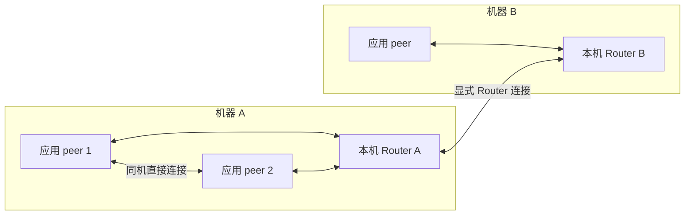

# 单机与多机部署拓扑

AOS 默认采用与 rmw_zenoh 相同的拓扑：每台机器运行一个 Zenoh Router，应用进程以 peer 模式连接本机 Router；gossip 交换连接信息，同机 peer 建立直接连接。跨机配置显式的 Router 连接，开发默认配置还保留 rmw_zenoh 的 Router 自动连接规则；下文的安全 profile 则限定 peer 只连接本机 Router。Router 不持有 AOS Node、Service handler 或 Action goal 的业务状态。

参考固定为 [ros2/rmw_zenoh@dda52d6d 的默认配置与多主机说明](https://github.com/ros2/rmw_zenoh/tree/dda52d6d9bc863b4b6c86a0b4fd1c6788f4a651e)。AOS 继续使用 Zenoh 1.10.1 及仓库记录的补丁。这是拓扑对齐；AOS 的 JSON 编码、key 与类型哈希仍与 ROS 2 不同，两个 SDK 不会因此直接互通。



## 开发默认配置

| 配置 | 默认行为 |
| --- | --- |
| `config/zenoh-session.json5` | `mode=peer`；连接 `tcp/localhost:7447`；监听 `tcp/localhost:0` |
| `config/zenoh-router.json5` | `mode=router`；监听 `tcp/[::]:7447`；跨 Router 的 `connect.endpoints` 初始为空 |
| `config/zenoh-router-windows.json5` | Windows 开发 Router；监听 `tcp/0.0.0.0:7447`，其余字段与公共 Router 配置一致 |
| 发现 | multicast 关闭，gossip 开启，`multihop=false`；Router 不自动连接其他 Router |
| 连接时序 | peer 可以先于 Router 启动，在后台连接和重连；Context 打开成功不表示网络已经就绪 |

默认 session 配置嵌入 SDK/CLI；Router 配置由独立进程读取，启动应用不会自动启动 Router。按[安装指南](../install.md)在每台机器启动一个 Router，再启动应用。已经建立直接连接的本机 peer 在 Router 暂时退出后仍可通信；新 peer 没有现成邻居时仍需要 Router 或显式入口来获得发现信息。

跨机开发时，在其中一台 Router 配置的 `connect.endpoints` 加入另一台 Router 的实际可达地址，例如 `tcp/192.168.1.10:7447`。只需一端主动建立连接，业务可双向转发。地址和端口由部署者提供；gossip 不负责穿透 NAT、打开防火墙或推导互联网地址。

开发默认 peer 也会尝试连接由 gossip 发现且可达的 Router，因此不能把这份开发配置描述成“peer 永远只连本机 Router”。安全 profile 将 peer 的 Router 自动连接关闭，才保证下面的每机入口边界。

Windows 使用专用 IPv4 Router 配置。本次原生测试确认，同一个 `[::]` listener 可接受 `::1`，却不能接受 `127.0.0.1`；这与 [Windows IPv6 socket 默认仅 IPv6](https://learn.microsoft.com/en-us/windows/win32/winsock/dual-stack-sockets)一致。公共配置保留 ROS 参考中的 `[::]`；禁用 IPv6 的其他主机也可显式使用 `tcp/0.0.0.0:7447`。Windows 配置的差异仅为监听地址，不改变 peer/gossip/Router 路由规则。

默认开发 Router 会监听网络接口，使用明文 TCP。跨不可信网络时使用下面的 mTLS 配置。需要保持单机隔离的开发者可以显式将 Router listener 改回 `tcp/127.0.0.1:7447`。

## 使用 TLS peer 与每机 Router

现有不含 `peer` 的 client profile 保持原来的单 Router client 行为。新部署在 session profile 中显式加入 `peer`，通过相同的 `aos.Context(security_profile=...)` 或 CLI `security_profile` 入口使用。

下面的 Python 片段根据已有的 `policy` 字典生成两个请求文件；它不签发证书、不打开连接。所有名称和文件路径都要替换为本次部署的实际值。

```python
import json
from pathlib import Path
import aos_sdk as aos

# policy 是符合 security-runtime.md 的完整有限权限策略。
# 示例策略包含 application_a / application_b 两个 subject id。
local_router = {
    "id": "router_a", "common_name": "router_a",
    "forward_subjects": ["application_a", "application_b"],
}
remote_router = {
    "id": "router_b", "common_name": "router_b",
    "forward_subjects": ["application_b"],
}
peer = {
    "schema_version": 1,
    "domain_id": policy["domain_id"],
    "router_endpoints": ["tls/127.0.0.1:7447"],
    "root_ca_certificate": "/absolute/ca.pem",
    "certificate": "/absolute/application_a.pem",
    "private_key": "/absolute/application_a.key",
    "peer": {
        "listen_endpoint": "tls/127.0.0.1:0",
        "policy": policy,
        "relays": [local_router],
    },
}
router = {
    "schema_version": 1,
    "listen_endpoints": ["tls/0.0.0.0:7447"],
    "root_ca_certificate": "/absolute/ca.pem",
    "certificate": "/absolute/router_a.pem",
    "private_key": "/absolute/router_a.key",
    "local_peers": True,
    "federation": {
        "connect_endpoints": ["tls/router-b.example:7447"],
        "relays": [remote_router],
    },
}
aos.client_security_config(peer)        # 同一 Rust 编译器校验 peer 与 ACL。
aos.router_security_config(router, policy)
Path("peer.json").write_text(json.dumps(peer))
Path("router-request.json").write_text(json.dumps({"router": router, "policy": policy}))
```

在机器 B 配置对应的主体、凭据、本机 peer 和 Router；若 A 主动连接 B，B 的 `connect_endpoints` 可以为空。两端的 `relays` 都必须列出需要信任的对端 Router CN。每台机器启动：

```sh
aos security serve --request /absolute/router-request.json
```

单机安全部署只需在 Router profile 设置 `local_peers: true`，省略整个 `federation`，无需任何远端 relay。peer 仍要把实际本机 Router 列为自己的 relay。`federation` 本身也会开启 gossip，此时 `local_peers: false` 不会将其关闭。Router profile 若同时省略 `local_peers` 和 `federation`，保持旧版 gossip 关闭的行为，供原有 strict client 部署继续使用。

确认本机 Router 已报告 `router_ready`，再运行使用 `/absolute/peer.json` 的应用。该事件只证明 TLS listener 初始化；跨机验收仍须检查业务结果。Router 可晚启动或暂时离线，已有 peer Context 会继续尝试连接；业务请求不会自动重放。

### 凭据与权限边界

peer listener 和本机 Router endpoint 必须使用字面量 loopback IP；不接受 `localhost`、LAN 地址或 endpoint 属性。peer 只通过 gossip 自动连接 peer，本机 Router 由 profile 显式指定。Router 可以显式连接最多 16 个 TLS endpoint，但不会因 gossip 自动扩张 Router 网络。

`connect_timeout_ms` 只控制旧 strict client 的启动等待。peer 固定使用后台连接，应省略此字段；非默认值会被拒绝，不能用它请求 peer fail-fast。

peer 与 Router 证书均需要 `serverAuth`、`clientAuth`；SAN 必须覆盖其他端实际连接它的地址。本机 peer 证书通常包含 `IP:127.0.0.1`。证书链、服务端名称、有效期和客户端身份验证覆盖全部 TLS 链路；peer 的直接连接同样运行默认拒绝 ACL。开发明文配置不是失败后的备用路径。

`relays` 是部署者明确授予 Router 的有限转发权限。编译器只复制 `forward_subjects` 指定的基础主体已有的 key、方向和操作，不接受任意通配规则、未知主体、身份冲突或递归委托。生成的 `expanded_grants` 标明来源主体，策略摘要包括 relay 配置。

跨 Router 时，下游看到的是相邻 Router 的证书身份。它不能据此恢复原始业务调用者身份；因此每个 Router 必须可信，入口 Router 必须执行客户端 ACL。中间 Router 的转发集合应仅包含它后方需要通行的主体；本机 peer 的 Router 转发集合应包含所有可能经 Router 与它交换消息的主体，包括直连尚未建立时的本机主体。证书、policy 与 relay 配置属于同一部署信任边界。

这一方案提供多机互联及链路恢复，不承诺任意 mesh 的故障切换、端到端调用者身份转发或持久任务恢复。多 Router 不会替代业务自身的存储与恢复策略。

## 可复现验收

- `cargo test -p aos-zenoh --test zenoh_config`：开发默认配置、晚启动 Router、gossip 直连及 Router 退出后继续通信。
- `cargo test -p aos-zenoh --test security_topology`：不带 federation 的 TLS Router 支持本机 peer 直连与拒绝；多 Router 阶段覆盖双向 Topic、Service、发现与连接恢复。该阶段一端使用 secure peer，另一端使用无 listener 的 strict client，防止 loopback peer 直连绕过待测 Router 链路，同时验证 peer 侧的 relay ACL。
- `scripts/platform_probe.py provider|client --security-profile /absolute/peer.json ...`：安装后独立进程运行 Topic、Service、Action 成功/取消、provider 重启和 Graph 消失/重新出现。`--security-profile` 与 `--config` 互斥；双方使用相同 probe 与固定候选 SHA。

真实多机报告还应记录每台 Router PID、ZID、本机 peer listener、显式 Router 连接、候选与二进制摘要，并区分同 LAN 和跨 LAN。一次本机测试、配置校验或端口连通不能代替这些部署证据。
